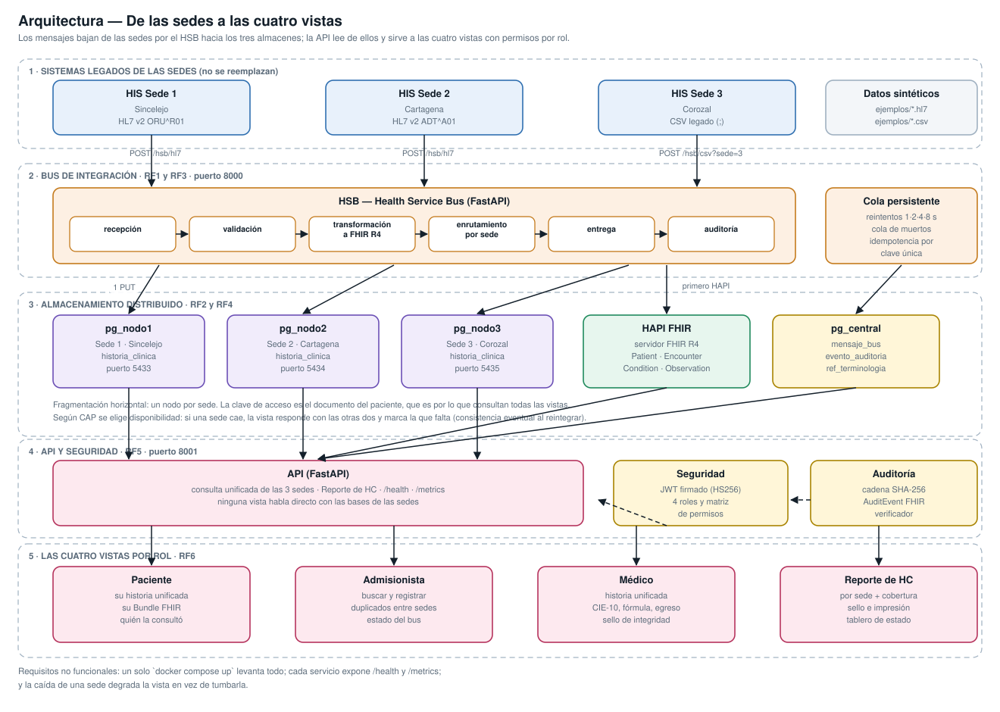
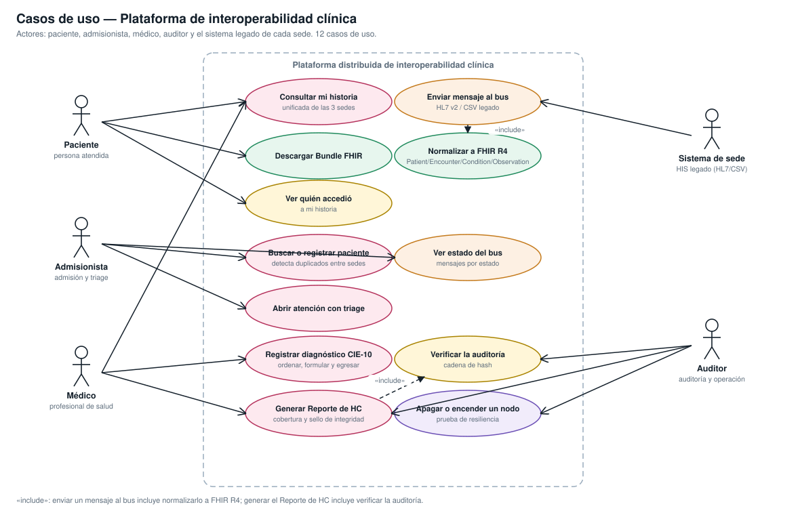
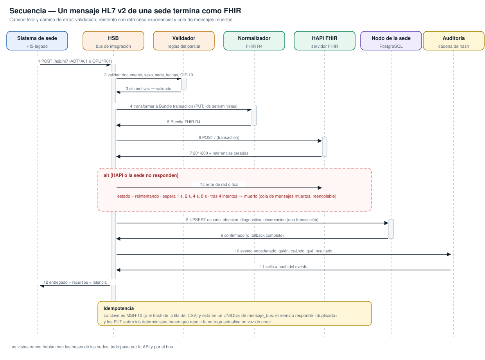
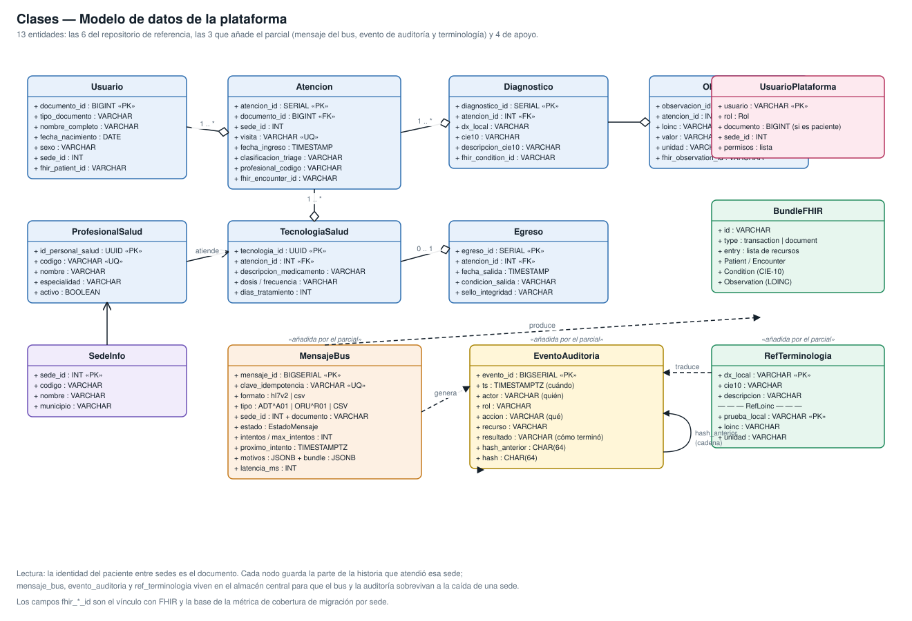
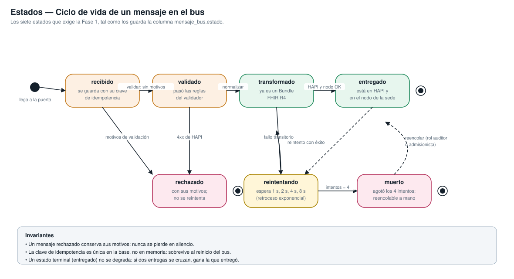

# Plataforma distribuida de interoperabilidad clínica para una red de IPS con tres sedes

**Parcial final — Sistemas Distribuidos**
Estructura de la plantilla v7. Cada sección indica la fase en la que se entrega.

> **Cómo usar este documento.** Es el contenido del informe, listo para pasar a
> la plantilla v7 del curso. Antes de entregar queda **una** cosa pendiente que
> nadie más puede hacer por usted: **verificar cada referencia de la
> sección 13.4 y añadir las fuentes de Latinoamérica que faltan**. La regla del
> parcial es explícita: no se aceptan referencias que no se hayan abierto.

---

## 1. Título, autores y resumen
*(Fases 1 y 5)*

**Título (14 palabras).** Plataforma distribuida de interoperabilidad clínica
con FHIR R4 y bus de integración para tres sedes.

**Autor.** Yeiner Julian Perez Vitola — Ingeniería de Sistemas — yeinerpv0205@gmail.com

*Trabajo individual.* El enunciado contempla equipos de dos estudiantes; este
parcial se desarrolló y se sustenta de forma individual.

### Resumen

La historia clínica de un paciente atendido en varias sedes de una misma red
de IPS queda fraccionada: cada sede conserva su sistema legado, con su propia
base de datos y su propio formato de salida. Este trabajo construye una
plataforma distribuida que la unifica sin reemplazar esos sistemas. El método
fue incremental, en cinco fases: se modeló el problema en UML, se levantó una
base PostgreSQL por sede (Sincelejo, Cartagena y Corozal) con datos
sintéticos y cobertura FHIR inicial del 0 %, se construyó un bus de
integración (HSB) que recibe HL7 v2 (ADT^A01 y ORU^R01) y CSV legado, los
valida, los normaliza a FHIR R4 (Patient, Encounter, Condition con CIE-10 y
Observation con LOINC) y los entrega a un servidor HAPI y al nodo de la sede
correspondiente, y se añadieron seguridad por rol, auditoría encadenada por
hash y cuatro vistas. Los resultados medidos sobre los mensajes de prueba
muestran una latencia media de extremo a extremo de 328 ms en frío y 221 ms
con el sistema caliente (p95 de 1 184 ms y 808 ms), entrega idempotente
comprobada (reenviar un mensaje no crea un segundo
paciente), recuperación automática tras apagar el servidor FHIR y una sede, y
cobertura de migración a FHIR que pasa del 0 % al 100 % en las tres sedes.
Los Bundle generados, tanto de tipo `transaction` como `document`, son
aceptados sin errores por el validador de HAPI. Una suite de 96 pruebas
automatizadas cubre los lectores, el validador, el normalizador, la cadena de
hash y los permisos por rol.

**Palabras clave:** sistemas distribuidos; interoperabilidad en salud; HL7
FHIR R4; bus de integración; historia clínica electrónica; idempotencia.

---

## 2. Introducción y objetivos
*(Fase 1)*

### 2.1 El problema

Una red de IPS atiende en tres sedes: Sincelejo, Cartagena y Corozal. Cada
sede tiene su propio sistema de información hospitalaria, comprado o
construido en momentos distintos, con su base de datos y su formato de
salida: dos sedes emiten mensajes HL7 v2 y la tercera exporta archivos CSV
con separador `;`. Un paciente que vive entre municipios —algo corriente en
la sabana de Sucre y en el área de Cartagena— termina con la historia
clínica repartida en tres lugares que no se hablan.

Las consecuencias son conocidas en la práctica clínica: el médico de
urgencias de Corozal no ve el diagnóstico de diabetes que le hicieron al
mismo paciente en Cartagena hace dos meses; se repiten exámenes de
laboratorio que ya existen; y el paciente, que es el dueño de su historia, no
tiene forma de verla completa ni de saber quién la consultó.

La salida fácil —reemplazar los tres sistemas por uno solo— no es viable:
cada sede tiene procesos, contratos y personal formado alrededor del suyo.
La salida correcta es la interoperabilidad: dejar que cada sede siga
trabajando con lo que tiene y construir encima una capa que traduzca,
enrute y unifique.

### 2.2 Objetivo general

Construir y desplegar una plataforma distribuida que unifique la historia
clínica de un paciente atendido en tres sedes, normalizando a FHIR R4 los
datos que cada sede emite en su propio formato, sin reemplazar los sistemas
legados y manteniendo el servicio cuando una sede no está disponible.

### 2.3 Objetivos específicos

1. **Reducir a una sola consulta** la obtención de la historia completa de un
   paciente con registros en las tres sedes. *Medición:* `GET
   /api/v1/historia/{documento}` devuelve las atenciones de las tres sedes en
   una sola llamada, y la prueba `test_una_sola_consulta_devuelve_la_historia_de_las_tres_sedes`
   lo verifica.
2. **Normalizar a FHIR R4 el 100 %** de los pacientes de las tres sedes,
   partiendo de un 0 % de cobertura. *Medición:* el endpoint
   `/api/v1/datos/cobertura` y el tablero muestran el porcentaje por sede
   antes y después de la migración.
3. **Procesar los dos formatos de entrada sin duplicar datos**, con reintentos
   y cola de mensajes muertos. *Medición:* los cuatro archivos de
   `ejemplos/` producen exactamente el resultado del contrato de su
   `LEEME.md`, y el reenvío de un mensaje responde `duplicado` dejando un
   solo paciente en HAPI y en la sede.
4. **Sostener la vista unificada con una sede caída** y detectar cualquier
   alteración de la auditoría. *Medición:* con `pg_nodo2` apagado la consulta
   responde con dos sedes y marca la tercera; el verificador señala el primer
   evento alterado de la cadena de hash.

---

## 3. Marco teórico y conceptual
*(Fase 1)*

### 3.1 Marco teórico

**Sistema distribuido y transparencia.** Un sistema distribuido es un
conjunto de computadores independientes que se presenta a sus usuarios como
un sistema único y coherente (Tanenbaum y Van Steen, 2017). Esa presentación
única es la *transparencia*. En esta plataforma la transparencia es parcial y
a propósito: el médico pide «la historia del paciente 1001» sin saber en qué
nodo está cada parte (transparencia de ubicación), pero cuando una sede no
responde el sistema **sí** se lo dice, porque ocultarlo sería peligroso en un
contexto clínico.

**Fallos parciales.** Es la diferencia de fondo entre un programa local y uno
distribuido: en el distribuido, una parte puede fallar mientras el resto
sigue viva, y el programa no siempre puede distinguir «el nodo está caído» de
«el nodo está lento». Por eso toda conexión de esta plataforma lleva
`connect_timeout` y toda entrega tiene reintentos: no se asume que el otro
lado contesta.

**Teorema CAP.** Ante una partición de red, un sistema distribuido solo puede
mantener consistencia o disponibilidad, no ambas (Brewer, 2000; Gilbert y
Lynch, 2002). Como la partición entre sedes es un hecho del escenario, la
elección real es la otra. Este trabajo elige **disponibilidad**: con una sede
caída la vista responde con las demás y marca la que falta, y la consistencia
se recupera de forma eventual cuando el bus entrega lo pendiente. La
justificación completa está en
[03_decisiones_arquitectura.md](03_decisiones_arquitectura.md).

**Propiedades ACID.** Atomicidad, consistencia, aislamiento y durabilidad son
las garantías de una transacción (Haerder y Reuter, 1983). En la plataforma
rigen **dentro de cada sede**: la escritura de paciente, atención,
diagnóstico y observación ocurre en una sola transacción de PostgreSQL. Entre
sedes no hay transacción distribuida, y la sección de decisiones explica por
qué un *two-phase commit* habría sido peor para este escenario.

**Fragmentación horizontal.** Repartir las filas de una tabla entre varios
nodos según el valor de una clave. Aquí la clave es la sede donde ocurrió la
atención, y dentro de cada sede el acceso es por documento del paciente, que
es por lo que consultan todas las vistas. La regla de la literatura es
elegir la clave por el patrón de acceso, no por comodidad: distribuir por una
columna que casi no se usa en las consultas obliga a recorrer todos los
nodos para todo.

**Idempotencia.** Una operación es idempotente cuando ejecutarla varias veces
deja el mismo estado que ejecutarla una vez. Es la propiedad que vuelve
seguros los reintentos: sin ella, reintentar un mensaje que sí se había
entregado crearía un paciente duplicado.

**Bus de integración (HSB).** Patrón de mensajería en el que los sistemas no
se conectan entre sí (lo que daría *n·(n-1)/2* integraciones) sino contra un
intermediario que recibe, valida, transforma, enruta y entrega (Hohpe y
Woolf, 2003). Con tres sedes y un servidor FHIR, el bus convierte seis
integraciones punto a punto en cuatro conexiones contra un único punto.

**HL7 v2.** Estándar de mensajería clínica vigente desde los años noventa y
todavía el más extendido en hospitales. Es posicional y delimitado: los
segmentos se separan por retorno de carro y los campos por `|`. Un `ADT^A01`
notifica una admisión; un `ORU^R01` entrega resultados de laboratorio.

**HL7 FHIR R4.** Estándar moderno de interoperabilidad basado en recursos
(`Patient`, `Encounter`, `Condition`, `Observation`), con representación JSON
y API REST (HL7 International, 2019). Frente a HL7 v2, su ventaja aquí es que
los recursos se pueden leer, validar y versionar con herramientas web
corrientes.

**Terminologías.** La interoperabilidad semántica necesita que las partes
signifiquen lo mismo, no solo que se entiendan sintácticamente. CIE-10
(Organización Mundial de la Salud, 2019) codifica diagnósticos y LOINC
(Regenstrief Institute, 2024) codifica pruebas de laboratorio. «DIARREA» no
es interoperable; `A09` sí.

### 3.2 Marco conceptual

| Concepto | Definición operativa en este proyecto |
| --- | --- |
| **Recurso** | Unidad de información clínica de FHIR con identidad propia y URL. Aquí: `Patient/pac-1007`, `Encounter/enc-V-S2-0101`. |
| **Perfil** | Restricción de un recurso para un contexto. No se definieron perfiles propios; se usa R4 base con extensiones estándar (nacionalidad, ocupación, DIVIPOLA). Queda como trabajo futuro un perfil colombiano. |
| **Bundle** | Contenedor de recursos. Se usan dos tipos: `transaction` (lo que el bus entrega a HAPI, con `PUT`, idempotente) y `document` (el que descarga el paciente, con `Composition` y una sección por sede). |
| **Terminología** | Tabla `ref_terminologia` (diagnóstico local → CIE-10) y `ref_loinc` (prueba local → LOINC), publicadas además como `ConceptMap`. |
| **API RESTful** | Interfaz sobre HTTP con sustantivos en la ruta y verbos en el método. Toda la plataforma se usa así; las vistas no tienen otro camino. |
| **Idempotencia** | Garantizada en dos niveles: la clave única de `mensaje_bus` (el mensaje repetido no vuelve a entrar) y los `PUT` sobre identificadores deterministas (la entrega repetida actualiza). |
| **Cola de mensajes muertos** | Mensajes que agotaron los cuatro intentos. No se borran: quedan en estado `muerto`, visibles en el tablero y reencolables. |
| **Sello de integridad** | SHA-256 del contenido. Dos usos: encadenar los eventos de auditoría y firmar el Reporte de HC. |
| **Cobertura FHIR** | Porcentaje de pacientes de una sede que ya tienen `fhir_patient_id`. Es la métrica de avance de la migración, y empieza en 0 %. |

---

## 4. Estado del arte
*(Fase 2)*

### 4.1 Panorama global

El problema de la historia fraccionada no es local. Los estándares HL7 v2 y
FHIR nacieron precisamente para eso, y la industria convergió en un patrón:
no reemplazar los sistemas existentes, sino poner un motor de integración
delante. La diferencia de la última década es FHIR: al exponer los datos
clínicos como recursos REST con JSON, bajó mucho la barrera de entrada frente
a las mensajerías anteriores.

### 4.2 Latinoamérica y Colombia

En Colombia el marco normativo empujó en la misma dirección. La **Ley 2015 de
2020** creó la Historia Clínica Electrónica Interoperable y la **Resolución
866 de 2021** del Ministerio de Salud y Protección Social definió los datos
mínimos de la interoperabilidad y adoptó FHIR como estándar de intercambio.
Antes de eso, la **Resolución 1995 de 1999** ya fijaba las normas de manejo
de la historia clínica, y la **Ley 1581 de 2012** regula el tratamiento de
datos personales, incluidos los de salud, que son datos sensibles. Este
proyecto se construye dentro de ese marco: datos mínimos, FHIR como formato
de intercambio y control de acceso por rol con registro de quién consultó
qué.

> **PENDIENTE 1 de 2 — añadir aquí dos o tres fuentes de Latinoamérica.**
> Artículos o informes sobre adopción de FHIR o interoperabilidad en salud en
> la región, **leídos**. La regla del parcial es explícita: no se aceptan
> referencias que no se hayan abierto. No las invente ni las copie de una
> lista: búsquelas, ábralas y cite lo que efectivamente dicen. Después,
> añádalas también a la sección 13.4 en formato APA 7.

### 4.3 Comparación de motores de integración

Tabla de compatibilidad pedida por la plantilla v7. La columna «Decisión» es
lo que se hizo en este trabajo.

| Criterio | HAPI FHIR | Mirth Connect | OpenHIM | Apache Camel | HSB propio (FastAPI) |
| --- | --- | --- | --- | --- | --- |
| Qué es | Servidor y librería FHIR | Motor de integración clínica | Mediador de intercambio en salud | Motor de rutas de integración general | Bus a medida |
| HL7 v2 | No es su función | Nativo, con conectores | Vía mediadores | Con el componente HL7 | Lector propio (~150 líneas) |
| FHIR | Implementación de referencia | Soportado | Orientado a FHIR | Con componente | Genera y valida contra HAPI |
| Curva de aprendizaje | Baja si solo se consume | Media (interfaz gráfica propia) | Media-alta | Alta (DSL de rutas) | Baja para quien sabe Python |
| Observabilidad | Logs y `$validate` | Panel propio | Panel propio | JMX y métricas | `/health` y `/metrics` propios, formato Prometheus |
| Se versiona en Git | Configuración sí | Los canales viven en su base | Parcial | Sí | Todo, incluidas las pruebas |
| Licencia | Apache 2.0 | MPL 2.0 (edición abierta) | Apache 2.0 | Apache 2.0 | Código propio |
| **Decisión** | **Se usa** como servidor FHIR y validador | Descartado: la configuración no se versiona ni se explica línea por línea | Descartado: resuelve más de lo que pide el alcance | Descartado: añade la JVM y un DSL nuevo | **Se construye**: es lo que el parcial evalúa |

El razonamiento completo está en
[03_decisiones_arquitectura.md](03_decisiones_arquitectura.md).

---

## 5. Solución propuesta y metodología
*(Fase 2)*

### 5.1 Arquitectura final



Cinco capas:

1. **Sistemas legados.** Tres sedes que siguen funcionando igual. Emiten HL7
   v2 (sedes 1 y 2) y CSV (sede 3).
2. **Bus de integración (HSB), puerto 8000.** Recibe, valida, transforma a
   FHIR, enruta por sede y entrega. Con cola persistente, reintentos con
   retroceso exponencial, cola de mensajes muertos e idempotencia.
3. **Almacenamiento distribuido.** Un PostgreSQL por sede (5433, 5434, 5435),
   un servidor HAPI FHIR (8080) y un almacén central (5436) con la cola del
   bus, la auditoría y las terminologías.
4. **API y seguridad, puerto 8001.** Consulta unificada, Reporte de HC, JWT
   con cuatro roles, auditoría encadenada, `/health` y `/metrics`.
5. **Las cuatro vistas por rol.** Paciente, Admisionista, Médico y Reporte de
   HC. Ninguna habla directo con las bases de las sedes.

### 5.2 Tecnologías y por qué

| Capa | Tecnología | Motivo |
| --- | --- | --- |
| Bus y API | Python 3.11 + FastAPI | Tipado con Pydantic, documentación OpenAPI automática, misma imagen para los dos servicios |
| Datos por sede | PostgreSQL 15 | Es lo que usa el repositorio de referencia; transacciones ACID, `ON CONFLICT`, índices parciales |
| FHIR | HAPI FHIR (R4) | Implementación de referencia y validador `$validate` |
| Seguridad | PyJWT (HS256) | Mínimo que admite la guía; sin contenedor extra |
| Despliegue | Docker Compose | Un solo comando levanta los siete contenedores |
| Pruebas | pytest + httpx | 96 pruebas: unitarias y de integración |
| Diagramas | Script Python → SVG, con fuente PlantUML | No depende de Java ni de servicios externos |

### 5.3 Metodología

Desarrollo incremental en las cinco fases del parcial, cada una con un
criterio de paso verificable antes de continuar. Cada fase dejó código que
funciona y pruebas que lo respaldan; no hubo una fase de «integración final»
donde todo se junta por primera vez, porque es ahí donde suelen aparecer los
problemas que no da tiempo de arreglar.

| Fase | Entregable | Criterio de paso | Estado |
| --- | --- | --- | --- |
| 1. Análisis, UML y diseño | Informe parcial y repositorio base | 4 diagramas coherentes y arquitectura aprobada | Cumplido |
| 2. Datos distribuidos y FHIR | 3 sedes con base propia y normalizador | Consulta unificada y Bundle válido | Cumplido |
| 3. HSB / middleware | Bus que recibe HL7 v2 y CSV y publica FHIR | Mensaje de extremo a extremo con reintento e idempotencia | Cumplido |
| 4. Seguridad y resiliencia | Token, roles, auditoría y prueba de caída | Caída de sede y acceso denegado demostrados | Cumplido |
| 5. Prototipo y sustentación | Las 4 vistas, informe y demostración | Demo completa desde cero | Cumplido |

La evidencia de cada criterio está en
[04_matriz_requisitos.md](04_matriz_requisitos.md).

### 5.4 La capa de datos en detalle

Cada nodo de sede tiene el esquema del repositorio de referencia (`usuario`,
`atencion`, `tecnologia_salud`, `diagnostico`, `egreso`,
`profesional_salud`) más lo que pide el parcial:

* `observacion` — resultados de laboratorio, que el esquema original no tenía
  y que hacen falta para `Observation`;
* `diagnostico.cie10` y `descripcion_cie10` — el diagnóstico codificado,
  junto al `dx_local` que conserva lo que dijo la sede;
* `fhir_patient_id`, `fhir_encounter_id`, `fhir_condition_id`,
  `fhir_observation_id` — el vínculo con FHIR y la base de la métrica de
  cobertura;
* `atencion.visita` con índice único — el identificador del encuentro en el
  legado, que es lo que hace idempotente la reentrega.

**Identidad del paciente entre sedes.** La regla de coincidencia es el
documento exacto. Es simple y, para datos sintéticos, suficiente. Su límite
conocido —el falso negativo que pide documentar la guía— es el documento mal
digitado: si la sede 2 registra `10017` en lugar de `1007`, la plataforma ve
dos personas distintas y la historia queda partida sin que nadie lo note. Un
falso positivo sería dos personas distintas registradas con el mismo
documento, que el sistema uniría en una sola historia: es el error más
peligroso de los dos. Resolverlo bien exige emparejamiento probabilístico
(Fellegi-Sunter), que la plantilla marca como bonus.

---

## 6. Modelado UML
*(Fase 1)*

Los cuatro diagramas están en [uml/](uml/), en imagen (`.svg`) y en fuente
editable (`.puml`). La comprobación de coherencia entre ellos está en
[00_INDICE.md](00_INDICE.md).

### 6.1 Casos de uso



Cinco actores (paciente, admisionista, médico, auditor y el sistema legado de
cada sede) y doce casos de uso. Dos relaciones `«include»`: enviar un mensaje
al bus incluye normalizarlo a FHIR, y generar el Reporte de HC incluye
verificar la auditoría.

### 6.2 Secuencia



Un mensaje HL7 v2 que entra por la puerta de una sede y termina como recursos
FHIR, con los dos caminos de error: el mensaje inválido (se rechaza con sus
motivos y se registra) y el fallo de entrega (reintentos con retroceso
exponencial y, al agotarlos, cola de mensajes muertos).

### 6.3 Clases



Trece entidades: las seis del repositorio de referencia, las tres que añade
el parcial (`mensaje_bus`, `evento_auditoria`, `ref_terminologia`) y las de
apoyo. Los nombres de columna coinciden con el esquema real.

### 6.4 Estados



Los siete estados del mensaje en el bus: `recibido`, `validado`,
`transformado`, `entregado`, `rechazado`, `reintentando` y `muerto`. Son
exactamente los valores que admite la restricción `ck_mensaje_estado` de la
tabla `mensaje_bus`.

### 6.5 Tabla de reglas de validación

La pide la plantilla v7. Es la que implementa
[hsb/validador.py](../hsb/validador.py) y se puede consultar en vivo en
`GET /hsb/reglas`.

| Campo | Regla | Si falla |
| --- | --- | --- |
| documento (`PID-3.1` / `documento`) | solo dígitos, 4 a 15 caracteres | rechazado: documento no numérico o longitud inválida |
| nombre (`PID-5` / `nombre`) | no vacío | rechazado: nombre vacío |
| sexo (`PID-8` / `sexo`) | M, F u O (se tolera vacío en el CSV legado) | rechazado: sexo no válido |
| sede (`MSH-4` / parámetro) | resuelve a la sede 1, 2 o 3 | rechazado: sede no reconocida |
| fecha de nacimiento (`PID-7`) | `YYYYMMDD` o ISO | rechazado: fecha no interpretable |
| fecha de ingreso (`PV1-44`) | `YYYYMMDDHHMM` o ISO | rechazado: fecha no interpretable |
| diagnóstico (`DG1-3`) | CIE-10 válido en HL7; mapeable por `ref_terminologia` en CSV | rechazado: diagnóstico sin mapeo a CIE-10 |
| prueba (`OBX-3`) | mapeable a LOINC y con valor en `OBX-5` | rechazado: prueba sin mapeo o sin valor |
| tipo de mensaje (`MSH-9`) | `ADT^A01` u `ORU^R01` | rechazado: tipo no soportado |

### 6.6 Mapeo de campos

En [02_mapeo_campos.md](02_mapeo_campos.md): 26 campos de origen con su tabla
y su recurso FHIR.

---

## 7. Proceso de desarrollo
*(Fase 3)*

### 7.1 Análisis y diseño

Se partió del repositorio de referencia `historia-clinica-distribuida`
(FastAPI, tres nodos PostgreSQL y un middleware que coordina consultas) y se
levantó tal cual para ver su comportamiento. Lo que ya servía se conservó: el
esquema clínico, el tablero de nodos, los módulos de admisión y de médico, y
el transformador de `Patient`. Lo que faltaba frente al enunciado se
construyó: el bus, el resto de la capa FHIR, la seguridad por rol, la
auditoría y dos de las cuatro vistas. La diferencia de fondo es que en el
repositorio original los tres nodos eran fragmentos por rango de documento;
aquí cada nodo **es una sede**, porque es lo que pide el escenario.

### 7.2 Desarrollo

Estructura del repositorio, la que exige la Fase 1:

```
app/      API y las cuatro vistas (FastAPI + plantillas)
hsb/      bus de integración: lectores, validador, cola, entrega, métricas
fhir/     normalizador a FHIR R4, terminologías y cliente HAPI
comun/    sedes, acceso a datos, seguridad y auditoría (compartido)
db/       esquemas y datos sintéticos de las sedes y del almacén central
docs/     informe, diagramas UML y anexos
tests/    96 pruebas unitarias y de integración
ejemplos/ los mensajes del contrato y la colección de pruebas
scripts/  espera de servicios, demostración y verificador de auditoría
```

### 7.3 Pruebas

96 pruebas automatizadas, ejecutables con `docker compose exec app pytest tests -v`:

| Archivo | Casos | Qué cubre |
| --- | --- | --- |
| `test_normalizador.py` | 13 | Normalizador a FHIR, incluidos dos casos inválidos |
| `test_lectores_y_validador.py` | 16 | HL7 v2, CSV legado y el contrato de `ejemplos/LEEME.md` |
| `test_terminologia_y_auditoria.py` | 23 | CIE-10, LOINC, `ConceptMap` y cadena de hash |
| `test_integracion_hsb.py` | 10 | Bus de extremo a extremo, idempotencia, `$validate`, métricas |
| `test_integracion_api.py` | 34 | Matriz de permisos, consulta unificada, reporte, ACID |

Las pruebas encontraron cuatro defectos reales que se corrigieron:

1. **Una carrera entre la entrega en línea y el trabajador de la cola.** Los
   dos procesaban el mismo mensaje y la segunda entrega chocaba en HAPI con
   un 409, que degradaba a `rechazado` un mensaje ya entregado. Se corrigió
   reservando el mensaje al entrar y prohibiendo degradar un estado terminal.
2. **El 409 de HAPI se trataba como error definitivo.** Es un conflicto de
   versión: merece reintento, no rechazo.
3. **Los Bundle no pasaban `$validate`.** Les faltaba `fullUrl` absoluto para
   resolver las referencias relativas. (Un primer intento con `urn:uuid:` no
   sirvió: esa forma exige UUID reales, y los identificadores son
   deterministas a propósito.)
4. **El bus sobreescribía datos del legado.** Un `ORU` con `Perez^Carlos`
   degradaba el nombre `Carlos Perez Ruiz` y movía la fecha de ingreso del
   encuentro. Ahora el bus completa lo que falta pero no pisa lo que la sede
   ya tiene.

### 7.4 Despliegue y CI/CD

El despliegue es un `docker compose up`. No hay canalización de integración
continua montada; el repositorio queda listo para añadirla, porque las
pruebas ya corren con un comando y el verificador de auditoría devuelve
código de salida 0 o 1 para usarse como paso de una canalización. Es trabajo
futuro declarado, no algo que se presente como hecho.

---

## 8. Diseño de interfaces
*(Fase 4)*

### 8.1 Las cuatro vistas

| Vista | Ruta | Rol | Qué muestra |
| --- | --- | --- | --- |
| Paciente | `/paciente` | paciente | Historia unificada ordenada por fecha con la sede de cada atención, descarga del Bundle FHIR y lista de accesos a su historia |
| Admisionista | `/admision` | admisionista | Búsqueda por documento que indica en qué sedes existe el paciente, registro con sede y triage, y estado de los mensajes en el bus. Sin diagnósticos |
| Médico | `/medico` | medico | Historia unificada de las tres sedes, diagnóstico CIE-10, fórmula y egreso; cada escritura devuelve su sello |
| Reporte de HC | `/reporte-hc` | medico, auditor, paciente (el suyo) | Reporte por sede con aviso si alguna no respondió, cobertura de campos con faltantes, sello SHA-256, impresión y Bundle; incluye el tablero de estado |

La pantalla de inicio de sesión (`/login`) es común y lleva a cada rol a su
vista. El tablero de nodos del repositorio de referencia se conserva como
pestaña de estado dentro del Reporte de HC, tal como pide el enunciado.

> **Pendiente — capturas.** Insertar aquí las capturas reales de las cuatro
> vistas y del tablero. Se toman con el sistema levantado; la lista de
> capturas recomendadas está al final de
> [05_guion_demo.md](05_guion_demo.md).

### 8.2 Accesibilidad

Lo que está implementado, no lo que sería deseable:

* **Contraste.** Texto principal `#e8edf5` sobre fondo `#0a0a14`: muy por
  encima del 4,5:1 que pide WCAG AA. Los estados no se comunican solo con
  color: «disponible» y «no disponible» van con texto.
* **Teclado.** Todo se recorre con el tabulador. El foco es visible
  (`:focus-visible` con contorno de 3 px) y hay un enlace «Saltar al
  contenido» al principio de cada vista.
* **Etiquetas.** Cada campo tiene su `<label for>`; los textos de ayuda se
  asocian con `aria-describedby`.
* **Lectores de pantalla.** Las pestañas usan `role="tab"` y
  `aria-selected`; los avisos van en regiones `aria-live`, de modo que un
  mensaje como «la sede Cartagena no respondió» se anuncia sin que el usuario
  tenga que buscarlo. Las tablas tienen `<caption>` y encabezados de fila.
* **Impresión.** El Reporte de HC tiene hoja de estilo de impresión: fondo
  blanco, tipografía serif legible y bloques que no se parten entre páginas.

Lo que falta: no se probó con un lector de pantalla real ni se midió con una
herramienta automática. Queda como trabajo futuro.

---

## 9. Prototipo final
*(Fase 5)*

### 9.1 Entorno de despliegue

Siete contenedores levantados con un comando:

| Servicio | Imagen | Puerto | Función |
| --- | --- | --- | --- |
| `pg_nodo1` | postgres:15 | 5433 | Sede 1 · Sincelejo |
| `pg_nodo2` | postgres:15 | 5434 | Sede 2 · Cartagena |
| `pg_nodo3` | postgres:15 | 5435 | Sede 3 · Corozal |
| `pg_central` | postgres:15 | 5436 | Cola del bus, auditoría, terminologías y base de HAPI |
| `hapi-fhir` | hapiproject/hapi | 8080 | Servidor FHIR R4 y validador |
| `hsb` | imagen propia | 8000 | Bus de integración |
| `app` | imagen propia | 8001 | API y las cuatro vistas |

Los tres nodos cargan su esquema y sus datos sintéticos en el primer
arranque, mediante los scripts de `docker-entrypoint-initdb.d`: no hay paso
manual de inicialización.

### 9.2 Criterios de aceptación frente a RF1–RF6

La tabla completa, con el comando que verifica cada uno, está en
[04_matriz_requisitos.md](04_matriz_requisitos.md). Resumen:

| Requisito | Estado |
| --- | --- |
| RF1 · Ingerir de 3 sedes en 2 formatos | Cumplido |
| RF2 · Normalizar a FHIR R4 en Bundle | Cumplido y validado contra HAPI |
| RF3 · HSB con ruteo, validación, cola, reintentos e idempotencia | Cumplido |
| RF4 · Datos distribuidos y consulta unificada | Cumplido |
| RF5 · Token, roles y auditoría encadenada | Cumplido |
| RF6 · Cuatro vistas por rol con tablero | Cumplido |
| RNF · Un solo comando | Cumplido |
| RNF · Degradación con una sede caída | Cumplido |
| RNF · `/health` y `/metrics` por servicio | Cumplido |

---

## 10. Viabilidad técnica
*(Fase 4)*

### 10.1 Escalabilidad

**Qué se escala primero si llegaran cien veces más mensajes.** El bus, y es
barato: el estado vive en la tabla `mensaje_bus`, los mensajes pendientes se
reclaman con `FOR UPDATE SKIP LOCKED` y la clave de idempotencia es una
restricción de la base. Varias réplicas del contenedor `hsb` pueden convivir
sin coordinarse entre ellas y sin procesar el mismo mensaje dos veces. No
hace falta cambiar código: basta `docker compose up --scale hsb=4`.

**Dónde está el siguiente cuello de botella.** En `pg_central`, porque toda
la cola y toda la auditoría pasan por ahí. Antes de llegar a ese punto hay
margen: índices sobre `estado` y `proximo_intento` (ya están), particionar
`mensaje_bus` por fecha y archivar los entregados. Si aun así no alcanza, es
el momento de un intermediario de mensajes dedicado.

**Qué no escala horizontalmente.** La escritura en una sede: es un
PostgreSQL por sede y ahí la única salida es vertical, o réplicas de lectura
para la consulta unificada (que es de solo lectura y sería la primera
candidata).

**Qué se escala sin tocar nada.** La API es sin estado: más réplicas detrás
de un balanceador y listo.

**Añadir una cuarta sede** es un registro en `comun/sedes.py`, un servicio en
el compose y sus dos scripts SQL. El bus, la API y las vistas no cambian.

### 10.2 Cumplimiento normativo

Distinción explícita entre lo implementado y lo que queda propuesto.

| Exigencia | Estado | Detalle |
| --- | --- | --- |
| **Ley 1581 de 2012** — acceso restringido a datos sensibles | **Implementado** | Cuatro roles con permisos distintos, verificados en la API. Un paciente solo ve su historia; el admisionista no ve diagnósticos |
| **Ley 1581 de 2012** — trazabilidad del tratamiento | **Implementado** | Cada lectura y cada escritura deja un evento encadenado con quién, cuándo, qué y resultado |
| **Habeas data** — el titular conoce el uso de sus datos | **Implementado** | La vista Paciente muestra quién accedió a su historia y cuándo |
| **Resolución 866 de 2021** — FHIR como estándar de intercambio | **Implementado** | FHIR R4 validado contra HAPI |
| **Resolución 1995 de 1999** — contenido de la historia clínica | **Parcial** | Están los campos de identificación, atención, diagnóstico, tecnologías y egreso; falta el resto del conjunto de datos |
| **Cifrado en tránsito** | **Propuesto** | Hoy el tráfico va en claro dentro de la red de Docker. Haría falta TLS en un proxy de entrada y entre servicios |
| **Cifrado en reposo** | **Propuesto** | Discos cifrados y cifrado por columna para los campos sensibles |
| **Autorización del titular / consentimiento** | **Propuesto** | FHIR tiene el recurso `Consent`; no se implementó |
| **Retención y supresión** | **Propuesto** | No hay política de retención ni derecho al olvido |
| **Gestión de secretos** | **Implementado a medias** | Fuera del repositorio, en variables de entorno y `.env` no versionado; faltaría un gestor de secretos y rotación |

Se declara explícitamente que **no se usó ningún dato real de pacientes**:
todos los datos son sintéticos y están en `db/sede/03_datos_sede*.sql` y en
`ejemplos/`.

---

## 11. Interoperabilidad basada en datos
*(Fase 3)*

### 11.1 Pilar técnico — demostrado

Que los sistemas puedan intercambiar bits y entenderse sintácticamente.

* **Entrada:** dos formatos reales de las sedes. HL7 v2 posicional
  (`ADT^A01` y `ORU^R01`) con segmentos separados por retorno de carro, y
  CSV con separador `;`.
* **Salida:** FHIR R4 sobre REST, en JSON, validado por el servidor de
  referencia.
* **Evidencia:** `POST /hsb/validar?contra_hapi=true` devuelve
  `"valido": true` para los Bundle `transaction`, y
  `GET /api/v1/reporte/{doc}/bundle/validar` hace lo mismo con el Bundle
  `document` del paciente.

### 11.2 Pilar semántico — demostrado

Que lo intercambiado signifique lo mismo en los dos extremos.

* **Diagnósticos:** la tabla `ref_terminologia` traduce el texto local a
  CIE-10 (`DIARREA` → `A09`, `HIPERTENSION` → `I10`, ocho entradas). El mapeo
  se publica como `ConceptMap` de FHIR en `GET /hsb/terminologia`.
* **Laboratorio:** `ref_loinc` traduce la prueba local a LOINC
  (`Hemoglobina` → `718-7`), con su unidad UCUM.
* **Lo que pasa si no hay mapeo:** el mensaje se rechaza con motivo. No se
  inventa un código ni se deja pasar texto libre a un campo codificado. Es la
  diferencia entre interoperabilidad semántica y un campo de texto con otro
  nombre.
* **Evidencia:** la fila `DOLOR MISTERIOSO` del CSV de la sede 3 se rechaza
  con «diagnóstico sin mapeo a CIE-10 en ref_terminologia».

### 11.3 Pilar organizacional — solo mencionado

Es el acuerdo entre instituciones sobre quién puede ver qué, con qué
propósito y bajo qué responsabilidad. Queda fuera del alcance del parcial
(se evalúa en Arquitectura TI). Lo único que esta plataforma aporta de ese
lado es el material para sostener el acuerdo: la matriz de permisos
(`GET /auth/matriz`) y la auditoría verificable, que es lo que permitiría a
una sede demostrar ante otra qué hizo con los datos que recibió.

---

## 12. Resultados y discusión
*(Fase 5)*

Las cifras medidas están en [07_resultados_medidos.md](07_resultados_medidos.md).
Resumen de lo observado en la ejecución de referencia:

| Métrica | Valor medido |
| --- | --- |
| Latencia media de extremo a extremo | 328 ms en frío · 221 ms en caliente |
| Percentil 95 de latencia | 1 184 ms en frío · 808 ms en caliente |
| Mensajes procesados | 16 (13 entregados, 3 rechazados) |
| Porcentaje de fallidos | 18,75 % (son exactamente los rechazos que manda el contrato de ejemplos; descontándolos, 0 %) |
| Duplicados frenados por idempotencia | comprobado: el reenvío responde `duplicado` y deja un solo paciente |
| Cobertura FHIR por sede | 0 % → 100 % en las tres |
| Recuperación tras caída de HAPI | mensaje entregado al reencolar, sin duplicar |
| Recuperación tras caída de una sede | automática, en menos de 5 s desde que la sede vuelve |

### Discusión

**Sobre la latencia.** Son de una máquina de desarrollo con todo en
contenedores locales, y la mayor parte del tiempo se va en la llamada HTTP a
HAPI, no en el procesamiento del bus: leer, validar y normalizar está por
debajo de 5 ms. La diferencia entre la corrida en frío (328 ms de media) y la
misma plataforma ya caliente (221 ms) son las cachés de HAPI, y el percentil
95 corresponde siempre a los primeros mensajes. No es
una medición de rendimiento comparable con la literatura: es una medición de
que el sistema funciona y de dónde está el tiempo. Una comparación seria
necesitaría una prueba de carga sostenida, que la plantilla marca como bonus.

**Sobre el porcentaje de fallidos.** El 18,75 % no es una tasa de error: son
exactamente los tres mensajes que el contrato de `ejemplos/LEEME.md` manda
rechazar. Descontándolos, la tasa de error es 0 %. Es una cifra que hay que leer con su contexto, y conviene decirlo
en la sustentación antes de que lo pregunten.

**Sobre la idempotencia.** Es el resultado del que más confianza se tiene,
porque está garantizada en dos capas independientes: la clave única en la
base (el mensaje repetido no vuelve a entrar) y los `PUT` sobre
identificadores deterministas (si entrara, actualizaría en vez de crear).
Que las dos capas sean independientes significa que un fallo en una no
rompe la garantía.

**Lo que no se midió.** Rendimiento bajo carga, comportamiento con varias
réplicas del bus en paralelo, y el coste de la consulta unificada con
volúmenes grandes por sede. Son las tres preguntas que seguirían.

---

## 13. Conclusiones, referencias y anexos
*(Fase 5)*

### 13.1 Conclusiones

1. **Se puede unificar sin reemplazar.** Las tres sedes siguen con su sistema
   y su formato, y aun así la historia de un paciente se consulta en una sola
   llamada. El trabajo real no estuvo en la unificación sino en la
   traducción: lectores por formato, validación con motivos y terminologías.
2. **La idempotencia hay que diseñarla, no añadirla.** Depende de haber
   elegido identificadores deterministas en el normalizador y una clave única
   en la base. Si los identificadores hubieran sido aleatorios —el error
   frecuente que advierte la guía—, ningún reintento habría sido seguro.
3. **La disponibilidad se paga con exactitud, y hay que decirlo en la
   pantalla.** La decisión de responder con dos sedes cuando falta una solo
   es aceptable porque la vista avisa y el reporte no se presenta como
   completo. Un reporte parcial que se muestre como completo es peor que un
   error.
4. **Las pruebas encontraron lo que la revisión no.** La carrera entre la
   entrega en línea y el trabajador de la cola no se veía leyendo el código;
   apareció al ejecutar el mismo mensaje dos veces.

### 13.2 Limitaciones

* El emparejamiento de pacientes es por documento exacto: un documento mal
  digitado parte la historia.
* No hay cifrado en tránsito entre contenedores.
* Los usuarios viven en el código (con claves por variable de entorno), no en
  un proveedor de identidad.
* No hay prueba de carga: las latencias son de una máquina de desarrollo.
* No hay canalización de integración continua, aunque las pruebas ya están
  listas para una.

### 13.3 Trabajo futuro

1. Keycloak como proveedor de identidad (el realm ya está preparado en
   `infra/keycloak/`).
2. Anclar el hash de la auditoría en Hyperledger Fabric.
3. Prometheus y Grafana sobre los `/metrics` que ya se exponen
   (`infra/observabilidad/`).
4. Emparejamiento probabilístico de pacientes.
5. Perfil FHIR colombiano con los datos mínimos de la Resolución 866 de 2021.
6. Manifiestos de Kubernetes probados en Minikube (`infra/k8s/`).

### 13.4 Referencias (APA 7)

> **PENDIENTE 2 de 2 — verifique cada referencia antes de entregar.** Abra el
> enlace, confirme el año y la versión, y borre las que no haya leído. La
> regla del parcial es que no se aceptan referencias que no se hayan abierto.
> Las que siguen son fuentes primarias y normativa vigente, elegidas porque se
> pueden consultar en línea y porque el trabajo las usó de verdad; aun así,
> **compruébelas una por una**.

Brewer, E. A. (2000). *Towards robust distributed systems* [Discurso de
apertura]. ACM Symposium on Principles of Distributed Computing (PODC),
Portland, OR, Estados Unidos.

Congreso de la República de Colombia. (2012). *Ley 1581 de 2012, por la cual
se dictan disposiciones generales para la protección de datos personales*.
Diario Oficial No. 48.587.

Congreso de la República de Colombia. (2020). *Ley 2015 de 2020, por medio de
la cual se crea la historia clínica electrónica interoperable*. Diario
Oficial No. 51.219.

Gilbert, S., y Lynch, N. (2002). Brewer's conjecture and the feasibility of
consistent, available, partition-tolerant web services. *ACM SIGACT News*,
33(2), 51–59. https://doi.org/10.1145/564585.564601

Haerder, T., y Reuter, A. (1983). Principles of transaction-oriented database
recovery. *ACM Computing Surveys*, 15(4), 287–317.
https://doi.org/10.1145/289.291

HL7 International. (2019). *HL7 FHIR Release 4 (v4.0.1)*.
https://hl7.org/fhir/R4/

HL7 International. (2007). *HL7 Version 2.5.1 Messaging Standard*.
https://www.hl7.org/implement/standards/

Hohpe, G., y Woolf, B. (2003). *Enterprise integration patterns: Designing,
building, and deploying messaging solutions*. Addison-Wesley.

Ministerio de Salud y Protección Social de Colombia. (1999). *Resolución 1995
de 1999, por la cual se establecen normas para el manejo de la historia
clínica*.

Ministerio de Salud y Protección Social de Colombia. (2021). *Resolución 866
de 2021, por la cual se establece el conjunto de elementos de datos
clínicos relevantes para la interoperabilidad de la historia clínica
electrónica*.

Organización Mundial de la Salud. (2019). *Clasificación Internacional de
Enfermedades, décima revisión (CIE-10)*. https://icd.who.int/

Regenstrief Institute. (2024). *LOINC: Logical Observation Identifiers Names
and Codes*. https://loinc.org/

Smile CDR. (2024). *HAPI FHIR: The open source FHIR API for Java*
[Documentación]. https://hapifhir.io/

Tanenbaum, A. S., y Van Steen, M. (2017). *Distributed systems: Principles
and paradigms* (3.ª ed.). Pearson.

**Faltan por añadir:** dos o tres fuentes académicas de Latinoamérica y
Colombia sobre adopción de FHIR o interoperabilidad en salud en la región.
Búsquelas, ábralas y cítelas en este mismo formato, en orden alfabético
entre las de arriba. Con las 14 que ya están, basta con dos más para superar
con holgura el mínimo de 8 que pide la rúbrica.

### 13.5 Anexos

| Anexo | Dónde |
| --- | --- |
| A. Código clave del bus | [hsb/](../hsb/) |
| B. Normalizador a FHIR | [fhir/normalizador.py](../fhir/normalizador.py) |
| C. Esquemas de base de datos | [db/](../db/) |
| D. Configuración del despliegue | [docker-compose.yml](../docker-compose.yml) |
| E. Pruebas automatizadas | [tests/](../tests/) |
| F. Mensajes de ejemplo y colección de pruebas | [ejemplos/](../ejemplos/) |
| G. Matriz de requisitos con su evidencia | [04_matriz_requisitos.md](04_matriz_requisitos.md) |
| H. Guion de la demostración | [05_guion_demo.md](05_guion_demo.md) |
| I. Bitácora y declaración de uso de IA | [06_bitacora.md](06_bitacora.md) |
| J. Resultados medidos | [07_resultados_medidos.md](07_resultados_medidos.md) |
| K. Decisiones de arquitectura | [03_decisiones_arquitectura.md](03_decisiones_arquitectura.md) |
